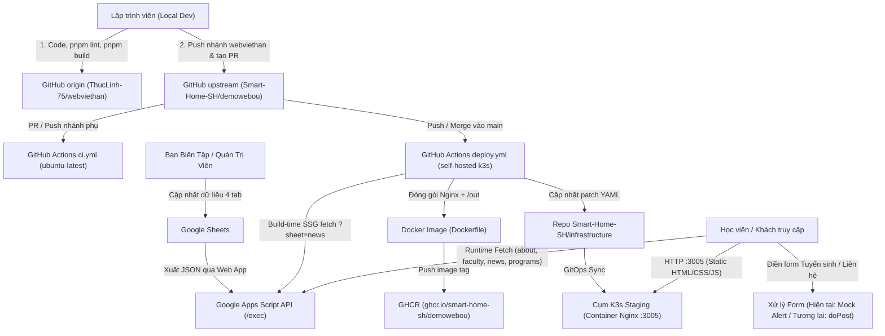
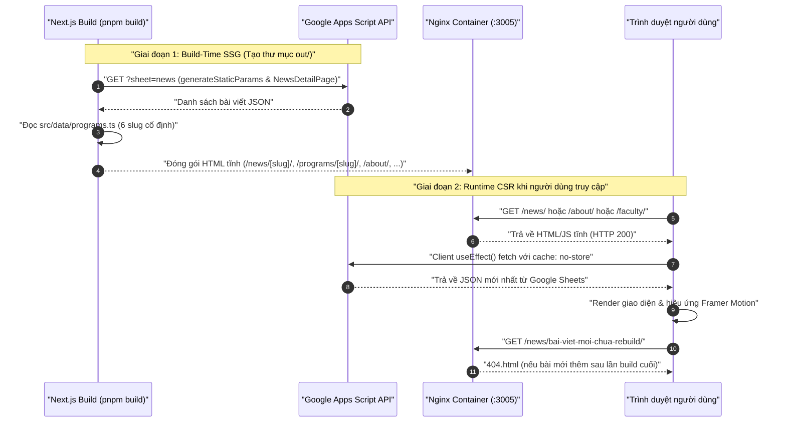
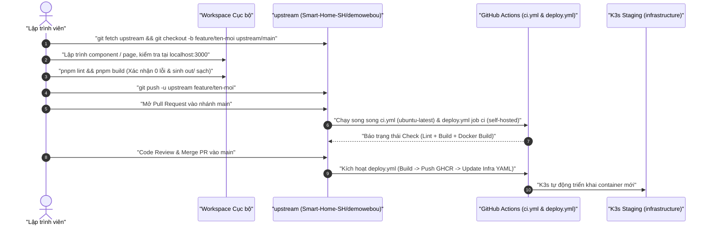
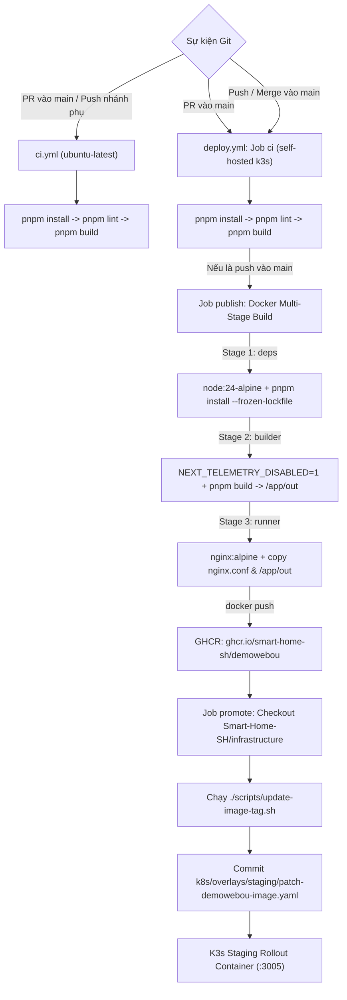

# ĐẶC TẢ QUY TRÌNH VẬN HÀNH & KỸ THUẬT DỰ ÁN (END-TO-END WORKFLOW SPECIFICATION)

**Dự án**: Website Cổng thông tin & Tuyển sinh — Trung Tâm Việt - Hàn (Trường Đại học Mở TP.HCM)  
**Mã kho lưu trữ**: `demoweb-ou-vhn` / `Smart-Home-SH/demowebou` (`trungtamviethan-demo`)  
**Nhánh hiện tại**: `webviethan`  
**Cập nhật lần cuối**: 23/11/2026  

---

## MỤC LỤC

1. [Tổng quan Kiến trúc & Bản đồ Vòng đời Hệ thống](#1-tổng-quan-kiến-trúc--bản-đồ-vòng-đời-hệ-thống)
2. [Luồng Xử lý Dữ liệu & Kết xuất Trang (Build-Time SSG vs Runtime CSR)](#2-luồng-xử-lý-dữ-liệu--kết-xuất-trang-build-time-ssg-vs-runtime-csr)
3. [Quy trình Đa ngôn ngữ (i18n) & Cơ chế Chống lỗi Hydration](#3-quy-trình-đa-ngôn-ngữ-i18n--cơ-chế-chống-lỗi-hydration)
4. [Quy trình Quản trị Nội dung Headless CMS (Google Sheets & Apps Script SOP)](#4-quy-trình-quản-trị-nội-dung-headless-cms-google-sheets--apps-script-sop)
5. [Quy trình Phát triển Phần mềm & Quản lý Mã nguồn (Development & Git Workflow)](#5-quy-trình-phát-triển-phần-mềm--quản-lý-mã-nguồn-development--git-workflow)
6. [Quy trình Kiểm thử & Đảm bảo Chất lượng (QA, Testing & Pre-Merge Checklist)](#6-quy-trình-kiểm-thử--đảm-bảo-chất-lượng-qa-testing--pre-merge-checklist)
7. [Quy trình CI/CD, Đóng gói Docker & Triển khai GitOps K3s](#7-quy-trình-cicd-đóng-gói-docker--triển-khai-gitops-k3s)
8. [Quy trình Nghiệp vụ Tuyển sinh & Liên hệ (Admissions & Contact Workflow)](#8-quy-trình-nghiệp-vụ-tuyển-sinh--liên-hệ-admissions--contact-workflow)
9. [Xử lý Sự cố & Vận hành (Troubleshooting & Incident Runbook)](#9-xử-lý-sự-cố--vận-hành-troubleshooting--incident-runbook)
10. [Các Điểm Nợ Kỹ thuật & Lộ trình Cải tiến Workflow](#10-các-điểm-nợ-kỹ-thuật--lộ-trình-cải-tiến-workflow)

---

## 1. TỔNG QUAN KIẾN TRÚC & BẢN ĐỒ VÒNG ĐỜI HỆ THỐNG

Hệ thống website Trung Tâm Việt - Hàn được thiết kế theo mô hình **Static Site Generation (SSG) kết hợp Client-Side Runtime Fetching** thông qua `next.config.ts` (`output: "export"`). Toàn bộ mã nguồn được biên dịch thành tập tin tĩnh HTML/CSS/JS đặt trong thư mục `out/`, đóng gói cùng Nginx Alpine thành container chạy ở cổng `3005`, không cần máy chủ Node.js chạy nền khi phục vụ người dùng cuối.

Toàn bộ dự án vận hành dựa trên **4 vòng đời đan xen**:
1. **Vòng đời Phát triển & Quản trị Mã nguồn (Development & Git/PR Flow)**: Lập trình viên phát triển trên nhánh tính năng, kiểm thử cục bộ bằng `pnpm`, đẩy mã lên `origin` (`ThucLinh-75/webviethan.git`) hoặc `upstream` (`Smart-Home-SH/demowebou.git`) và mở Pull Request.
2. **Vòng đời Quản trị Nội dung (Content Management Flow)**: Ban biên tập cập nhật bài viết, thông tin giới thiệu, giảng viên và khóa học trực tiếp trên Google Sheets thông qua Google Apps Script Web App API.
3. **Vòng đời Đóng gói & Triển khai GitOps (Build / CI-CD / K3s Deployment Flow)**: GitHub Actions kiểm tra tự động (`ci.yml`), đóng gói Docker image đa tầng (`Dockerfile`), đẩy image lên GHCR (`ghcr.io/smart-home-sh/demowebou`) và cập nhật manifest hạ tầng trong `Smart-Home-SH/infrastructure` để K3s Staging tự động rollout.
4. **Vòng đời Tương tác Người dùng & Tuyển sinh (User Runtime & Lead Flow)**: Người dùng truy cập Nginx `:3005`, trình duyệt nạp HTML tĩnh, kích hoạt `LanguageProvider` (`vi`/`en` từ `localStorage`), gọi API Google Sheets lấy dữ liệu thời gian thực (cho các trang CSR) và gửi biểu mẫu tuyển sinh/liên hệ.



### Bản đồ Tuyến trang (Routes Matrix)

| Tuyến đường (Route) | Tệp mã nguồn | Loại Component | Nguồn dữ liệu chính | Cần Rebuild khi sửa nội dung? |
| :--- | :--- | :--- | :--- | :--- |
| `/` | `src/app/page.tsx` | Client (`"use client"`) | 5 section tĩnh (`HeroSection`, `FeatureGrid`, `StatsCounter`, `CTABanner`, `PartnersSection`) + `LatestNews` fetch runtime `?sheet=news` | **Không** (3 tin mới nhất tự cập nhật runtime) |
| `/about` | `src/app/about/page.tsx` | Client (`"use client"`) | Fetch runtime `?sheet=about` + fallback tĩnh | **Không** (trừ 3 thẻ Highlights đang hardcode trong JSX) |
| `/programs` | `src/app/programs/page.tsx` | Client (`"use client"`) | Fetch runtime URL gốc (không có `?sheet=`) | **Không** cho danh sách, nhưng **Có** nếu thêm `slug` mới cho trang chi tiết |
| `/programs/[slug]` | `src/app/programs/[slug]/page.tsx` + `ProgramDetailClient.tsx` | Server SSG + Client UI | Dữ liệu tĩnh `programs` trong `src/data/programs.ts` qua `generateStaticParams()` | **Có** (bắt buộc sửa `src/data/programs.ts` và rebuild) |
| `/faculty` | `src/app/faculty/page.tsx` | Client (`"use client"`) | Fetch runtime `?sheet=faculty`, lọc `item["Hiển thị"] === true` | **Không** (cập nhật tức thì) |
| `/news` | `src/app/news/page.tsx` | Client (`"use client"`) | Fetch runtime `?sheet=news`, chuẩn hóa trường `featured` | **Không** cho danh sách, nhưng **Có** nếu thêm bài mới |
| `/news/[slug]` | `src/app/news/[slug]/page.tsx` + `NewsDetailClient.tsx` | Server SSG + Client UI | Fetch **lúc build** (`generateStaticParams`, `generateMetadata`, `NewsDetailPage`) từ `?sheet=news` | **Có** (bắt buộc rebuild & deploy để sinh file HTML cho slug mới) |
| `/admissions` | `src/app/admissions/page.tsx` | Client (`"use client"`) | Quy trình 4 bước & FAQ tĩnh + danh sách `programs` từ `src/data/programs.ts` + Form state | **Có** (dữ liệu viết trực tiếp trong component) |
| `/contact` | `src/app/contact/page.tsx` | Client (`"use client"`) | `siteConfig` từ `src/data/site.ts` + Form state | **Có** (nếu đổi thông tin liên hệ trong `site.ts`) |
| `404` | `src/app/not-found.tsx` | Server Component | Nội dung tĩnh (`404.html` được Nginx trỏ tới) | **Có** |

---

## 2. LUỒNG XỬ LÝ DỮ LIỆU & KẾT XUẤT TRANG (BUILD-TIME SSG VS RUNTIME CSR)

### 2.1. Cấu hình xuất tĩnh (`next.config.ts`)
Dự án cấu hình Next.js 16 (`16.3.3`) xuất toàn bộ ứng dụng ra file tĩnh:
```ts
const nextConfig: NextConfig = {
  output: "export",
  trailingSlash: true,
  images: {
    unoptimized: true,
  },
};
```
- `output: "export"`: Lệnh `pnpm build` tạo ra thư mục `out/` chứa các tệp HTML cho từng route (ví dụ: `/about/index.html`, `/news/index.html`, `/404.html`).
- `trailingSlash: true`: Chuẩn hóa URL kết thúc bằng dấu `/` (ví dụ `/programs/`), khớp với quy tắc `try_files $uri $uri.html $uri/ /index.html;` trong `nginx.conf`.
- `images: { unoptimized: true }`: Tắt Image Optimization Server của Next.js vì không có runtime Node.js trong container Nginx.

### 2.2. Hành vi chi tiết từng trang

#### A. Trang chủ (`/`) — `src/app/page.tsx` & `src/components/home/LatestNews.tsx`
1. Khi mount, `Home()` hiển thị spinner `<Loader2 />` trong **300ms** (`setTimeout(..., 300)`) rồi render 6 khối: `HeroSection`, `FeatureGrid`, `StatsCounter`, `LatestNews`, `CTABanner`, `PartnersSection`.
2. `LatestNews` gọi `getNewsArticles()` từ `src/data/news.ts` với `fetch(API_URL, { cache: "no-store" })`, lọc các item có `item.slug` khác rỗng, rồi lấy tối đa 3 bài đầu tiên (`articles.slice(0, 3)`).
3. Nếu danh sách rỗng hoặc lỗi mạng, `LatestNews` trả về `null` (tự động ẩn section thay vì làm vỡ bố cục).

#### B. Trang Giới thiệu (`/about`) — `src/app/about/page.tsx`
1. Khi mount, `useEffect` gọi `fetch("...?sheet=about", { cache: "no-store" })`.
2. Dữ liệu mảng trả về được ánh xạ vào state `content` theo khóa `"Mã nội dung"`:
   `contentMap[row["Mã nội dung"]] = { vi: row["Tiếng Việt"] || "", en: row["Tiếng Anh"] || "" }`.
3. Hàm `getText(key, fallbackVi, fallbackEn)` ưu tiên văn bản từ Google Sheets; nếu thiếu khóa hoặc API lỗi, tự động dùng chuỗi dự phòng hardcode theo `locale`.
4. Lưu ý: Khối 3 thẻ nổi bật (*Chứng nhận chuẩn quốc tế*, *Giảng viên giàu kinh nghiệm*, *Mạng lưới đối tác rộng lớn*) hiện đang được viết tĩnh theo điều kiện `locale === "vi" ? ... : ...` trong component.

#### C. Trang Đội ngũ Giảng viên (`/faculty`) — `src/app/faculty/page.tsx`
1. Gọi `fetch("...?sheet=faculty", { cache: "no-store" })`.
2. Lọc nghiêm ngặt các bản ghi có `item["Hiển thị"] === true` (kiểu boolean).
3. Avatar được tạo tự động bằng `getInitials(member["Tên"])` (lấy chữ cái đầu của từ cuối cùng trong họ tên, mặc định `"VH"`).
4. Lưu ý: Tệp `src/data/faculty.ts` hiện tồn tại dưới dạng dữ liệu mẫu tĩnh nhưng không được `faculty/page.tsx` import làm fallback.

#### D. Trang Chương trình & Chi tiết (`/programs` & `/programs/[slug]`)
- **Trang danh sách (`/programs`)**: Fetch runtime từ URL gốc Apps Script (không kèm `?sheet=`), lưu vào state `programs`, lọc client-side theo `active` (`all`, `korean`, `topik`, `exchange`) với hiệu ứng `AnimatePresence mode="popLayout"` của Framer Motion.
- **Trang chi tiết (`/programs/[slug]`)**: Là **Server Component thuần SSG** đọc trực tiếp từ mảng tĩnh `programs` trong `src/data/programs.ts` qua `generateStaticParams()` và `getProgramBySlug(slug)`. Hiện có 6 slug cố định:
  1. `korean-language-culture`
  2. `korean-business`
  3. `korean-topik-prep`
  4. `korean-communication`
  5. `exchange-program-korea`
  6. `scholarship-korea-gks`

#### E. Trang Tin tức & Chi tiết (`/news` & `/news/[slug]`)
- **Trang danh sách (`/news`)**: Fetch runtime từ `?sheet=news`, chuẩn hóa `featured` thành boolean (`true | "TRUE" | "true"`). Các bài `featured: true` được đổi nền thẻ sang gradient xanh đậm (`from-primary-600 to-primary-900`).
- **Trang chi tiết (`/news/[slug]`)**:
  - Tại thời điểm `pnpm build`, hàm `generateStaticParams()` gọi `API_URL` (`?sheet=news`), kiểm tra `Array.isArray(data)` và lọc `article.slug != null && String(article.slug).trim() !== ""` để sinh danh sách route tĩnh.
  - Với mỗi slug, `generateMetadata()` và `NewsDetailPage()` tiếp tục gọi `getArticleFromSheets(slug)` để tạo HTML tĩnh và thẻ SEO `<title>`, `<meta name="description">`.
  - Tại trình duyệt, `NewsDetailClient` hỗ trợ nút Chia sẻ (`navigator.share` trên thiết bị hỗ trợ hoặc `navigator.clipboard.writeText` + `alert` dự phòng) và hiển thị nội dung giữ nguyên xuống dòng nhờ class `whitespace-pre-wrap`.



---

## 3. QUY TRÌNH ĐA NGÔN NGỮ (i18n) & CƠ CHẾ CHỐNG LỖI HYDRATION

### 3.1. Luồng khởi tạo ngôn ngữ
1. `src/app/layout.tsx` (`RootLayout`) nạp 2 font Google (`Inter` và `Be_Vietnam_Pro` với subset `latin`, `vietnamese`, `display: "swap"`) và bọc toàn bộ ứng dụng trong `<LanguageProvider>`.
2. `src/components/providers/LanguageProvider.tsx` sử dụng **Lazy State Initializer** trong `useState<Locale>`:
   - Khi chạy trên server/build-time (`typeof window === "undefined"`): mặc định trả về `"vi"`.
   - Khi chạy trên trình duyệt: đọc `localStorage.getItem("locale")`; nếu hợp lệ (`"vi"` hoặc `"en"`) thì dùng giá trị đó, ngược lại dùng `"vi"`.
3. Khi người dùng nhấn nút chuyển ngôn ngữ (icon `Globe`) trên `Header.tsx`, `toggleLocale()` đổi giữa `"vi"` và `"en"`, cập nhật React state và ghi đè `localStorage.setItem("locale", newLocale)`.
4. Toàn bộ các component tiêu thụ dữ liệu dịch qua hook `useLanguage()` trả về `{ locale, setLocale, toggleLocale, t }` với `t = translations[locale]` định nghĩa theo `TranslationSchema` trong `src/data/i18n.ts`.

### 3.2. Quy tắc chống lỗi Hydration Mismatch
Vì HTML xuất tĩnh luôn được build với ngôn ngữ mặc định `"vi"`, nhưng trình duyệt người dùng có thể có sẵn `localStorage.locale === "en"`, React sẽ báo lỗi Hydration nếu nội dung text giữa Server HTML và Client Render đầu tiên khác nhau. Do đó, dự án quy định:
- Mọi thẻ chứa text dịch động phụ thuộc vào `locale` hoặc `t` (trong `Header.tsx`, `Footer.tsx`, `programs/page.tsx`, v.v.) **phải gắn `suppressHydrationWarning`** trực tiếp lên phần tử text đó (ví dụ `<span suppressHydrationWarning>{navLabels[i]}</span>`) và thẻ `<html suppressHydrationWarning>` ở `src/app/layout.tsx`.
- Khi lập trình viên thêm khóa giao diện mới vào `src/data/i18n.ts`:
  1. Cập nhật interface `TranslationSchema`.
  2. Bổ sung đầy đủ cả 2 nhánh `translations.vi` và `translations.en` (TypeScript `strict: true` sẽ báo lỗi compile nếu thiếu 1 trong 2 ngôn ngữ).
  3. Bọc phần tử hiển thị bằng `suppressHydrationWarning`.

---

## 4. QUY TRÌNH QUẢN TRỊ NỘI DUNG HEADLESS CMS (GOOGLE SHEETS & APPS SCRIPT SOP)

### 4.1. Điểm cuối API (Apps Script Endpoint)
Tất cả các trang động đang kết nối tới Web App URL:
`https://script.google.com/macros/s/AKfycbxXlwsAgGNIM0k0yh84EcxW_4f6AS120rcuw6B38-fKWtZxhPYwjoazgLnNXvKQ5DNN/exec`

### 4.2. Đặc tả Schema chi tiết từng Tab Google Sheets

#### Tab 1: `about` (`?sheet=about`) — Cập nhật tức thì (Không cần rebuild)
| Tên cột bắt buộc | Kiểu dữ liệu | Mô tả |
| :--- | :--- | :--- |
| `Mã nội dung` | String | Khóa định danh để code ánh xạ (xem danh sách 10 khóa chuẩn bên dưới) |
| `Tiếng Việt` | String | Nội dung hiển thị khi `locale === "vi"` |
| `Tiếng Anh` | String | Nội dung hiển thị khi `locale === "en"` |

**10 mã nội dung được `src/app/about/page.tsx` đọc trực tiếp**:
- `tieu_de_chinh`, `phu_de`, `mo_ta_chinh`
- `su_menh_tieu_de`, `su_menh_mo_ta`
- `tam_nhin_tieu_de`, `tam_nhin_mo_ta`
- `lich_su_tieu_de`, `lich_su_1`, `lich_su_2`

#### Tab 2: `faculty` (`?sheet=faculty`) — Cập nhật tức thì (Không cần rebuild)
| Tên cột bắt buộc | Kiểu dữ liệu | Ghi chú kỹ thuật |
| :--- | :--- | :--- |
| `ID` | String / Number | Dùng làm React `key` |
| `Tên` | String | Dùng hiển thị tên & lấy chữ cái cuối cho Avatar |
| `Chức vụ VI` / `Chức vụ EN` | String | Chức vụ song ngữ |
| `Chuyên môn VI` / `Chuyên môn EN` | String | Lĩnh vực chuyên môn song ngữ |
| `Mô tả VI` / `Mô tả EN` | String | Tiểu sử giảng viên song ngữ |
| `Đơn vị VI` / `Đơn vị EN` | String | Đơn vị công tác (footer của thẻ) |
| `Hiển thị` | **Boolean (`TRUE` / `FALSE`)** | **Quan trọng**: Code kiểm tra nghiêm ngặt `item["Hiển thị"] === true`. Ô Google Sheets phải dùng Checkbox hoặc giá trị boolean `TRUE`, không nhập chuỗi `"true"` hoặc `"Có"`. |

#### Tab 3: `programs` (Tab mặc định — Không truyền `?sheet=`) — Cần lưu ý trang chi tiết
| Tên cột bắt buộc | Kiểu dữ liệu | Ghi chú kỹ thuật |
| :--- | :--- | :--- |
| `slug` | String | Viết thường, không dấu, nối bằng `-` |
| `title` / `titleEn` | String | Tên khóa học Việt / Anh |
| `category` | Enum String | Chỉ nhận 1 trong 3 giá trị: `"korean"`, `"topik"`, `"exchange"` |
| `description` / `descriptionEn` | String | Mô tả ngắn |
| `duration` | String | Thời lượng (ví dụ: `"12 tháng"`) |
| `features` | Array of Strings | Danh sách điểm nổi bật (hiển thị tối đa 3 mục đầu trên card) |

> **Cảnh báo vận hành cho Tab `programs`**: Trang danh sách `/programs` lấy dữ liệu trực tiếp từ Google Sheets, nhưng trang chi tiết `/programs/[slug]` lại build tĩnh từ `src/data/programs.ts`. Nếu thêm một khóa học có `slug` mới trên Google Sheets mà chưa thêm vào `src/data/programs.ts` và rebuild, người dùng bấm *"Xem chi tiết"* sẽ gặp trang **404**.

#### Tab 4: `news` (`?sheet=news`) — Sửa bài cũ tức thì, Thêm bài mới cần Rebuild
| Tên cột bắt buộc | Kiểu dữ liệu | Ghi chú kỹ thuật |
| :--- | :--- | :--- |
| `slug` | String | Duy nhất, không dấu, không khoảng trắng (nếu rỗng sẽ bị lọc bỏ) |
| `title` / `titleEn` | String | Tiêu đề bài viết song ngữ |
| `category` | String | Phân loại (ví dụ: `announcement`, `event`, `scholarship`) |
| `date` | String | Ngày đăng (ví dụ: `2026-11-23` hoặc `23/11/2026`) |
| `excerpt` / `excerptEn` | String | Đoạn tóm tắt hiển thị ở thẻ tin tức & meta SEO |
| `content` / `contentEn` | String | Nội dung đầy đủ bài viết (hỗ trợ xuống dòng `Enter` nhờ CSS `whitespace-pre-wrap`) |
| `featured` | Boolean / String | Nhận `TRUE`/`FALSE` hoặc `"true"`. Nếu đúng, thẻ tin tức trên `/news` sẽ đổi sang màu xanh đậm nổi bật. |

> **Cảnh báo vận hành cho Tab `news`**: Khi thêm một dòng tin tức với `slug` mới trên Sheets, trang chủ (`LatestNews`) và trang `/news` sẽ hiện bài mới ngay lập tức, **nhưng đường dẫn `/news/<slug-moi>/` sẽ trả về 404** cho tới khi pipeline CI/CD chạy lại `pnpm build` (vì `generateStaticParams()` chỉ sinh file HTML cho các slug tồn tại tại thời điểm build).

### 4.3. Quy trình thao tác chuẩn cho Biên tập viên (Editorial SOP)
1. **Bước 1**: Mở Google Spreadsheet quản trị, chọn đúng tab (`about`, `faculty`, `programs`, `news`).
2. **Bước 2**: Điền đầy đủ cả cột Tiếng Việt và Tiếng Anh. Kiểm tra `slug` không có ký tự tiếng Việt có dấu hoặc khoảng trắng.
3. **Bước 3**: Với bài viết `news`, dùng tổ hợp `Alt + Enter` trong ô Google Sheets để tạo đoạn văn bản xuống dòng sạch đẹp.
4. **Bước 4**: Mở trình duyệt ẩn danh kiểm tra trang danh sách (`/news`, `/faculty`, `/about`, `/programs`) và chuyển đổi qua lại nút `VI / EN`.
5. **Bước 5**: Nếu thao tác vừa rồi **thêm bài viết `news` có `slug` mới**, thông báo cho bộ phận kỹ thuật kích hoạt re-run workflow `deploy.yml` trên GitHub Actions (hoặc đẩy 1 commit trống) để Next.js xuất file HTML tĩnh cho đường dẫn bài viết mới.

---

## 5. QUY TRÌNH PHÁT TRIỂN PHẦN MỀM & QUẢN LÝ MÃ NGUỒN (DEVELOPMENT & GIT WORKFLOW)

### 5.1. Thiết lập môi trường phát triển (Local Environment)
- **Runtime**: Node.js `v20`–`v24` (CI trên `ubuntu-latest` dùng Node 22; `Dockerfile` và `deploy.yml` hiện tại dùng Node 24; `upstream/main` dùng Node 20).
- **Trình quản lý gói bắt buộc**: **pnpm `9.12.2`** qua Corepack (khớp trường `packageManager` trong `package.json`). Không dùng `npm install` hay cập nhật `package-lock.json` để tránh xung đột lockfile với `pnpm-lock.yaml`.

```bash
# Kích hoạt pnpm đúng phiên bản
corepack enable
corepack prepare pnpm@9.12.2 --activate

# Cài đặt thư viện
pnpm install --frozen-lockfile

# Chạy máy chủ dev (Hot Reload tại http://localhost:3000)
pnpm dev
```

### 5.2. Quy chuẩn Giao diện & Styling (Tailwind CSS v4)
- Dự án sử dụng Tailwind CSS v4 cấu hình **CSS-first** qua `@theme` trong `src/app/globals.css` (không dùng `tailwind.config.ts`).
- Hệ thống token màu thương hiệu đã định nghĩa sẵn:
  - `primary-50` .. `primary-900` (Xanh đại học: `#1e40af` tại `primary-500`, `#1e2a5e` tại `primary-900`).
  - `accent-50` .. `accent-600` (Vàng điểm nhấn: `#facc15` tại `accent-400`, `#eab308` tại `accent-500`).
  - Font biến CSS: `--font-heading` (`Be Vietnam Pro`), `--font-body` (`Inter`).
  - Lớp tiện ích toàn cục: `.section-padding`, `.container-custom`, `.gradient-primary`, `.gradient-accent`, `.text-gradient`, và media query `@media (prefers-reduced-motion: reduce)`.
- Các thành phần giao diện mới phải tái sử dụng thư viện UI trong `src/components/ui/` (`Badge`, `Button`, `Card`, `Input`, `SectionHeading`, `SocialIcons`, `Textarea`) và hàm gộp class `cn()` trong `src/lib/utils.ts`.

### 5.3. Kiến trúc Remote & Phân nhánh Git (Git Topology)
Kho mã nguồn cục bộ cấu hình 2 remote:
- `origin`: `https://github.com/ThucLinh-75/webviethan.git` (kho lưu trữ cá nhân / bản sao làm việc).
- `upstream`: `https://github.com/Smart-Home-SH/demowebou.git` (kho lưu trữ chính của tổ chức, nơi chạy pipeline CI/CD staging).

**Quy ước đặt tên nhánh**:
- `main`: Nhánh gốc ổn định của `upstream`. Mọi push/merge vào `main` sẽ tự động build Docker image và deploy lên cụm K3s Staging.
- `webviethan`: Nhánh tích hợp tính năng hoàn thiện website Trung tâm Việt - Hàn được tạo từ `upstream/main`.
- `feature/<ten-tinh-nang>`: Nhánh phát triển tính năng mới (ví dụ `feature/admissions-api`).
- `fix/<ten-loi>`: Nhánh vá lỗi (ví dụ `fix/news-slug-encoding`).
- `docs/<noi-dung>` / `chore/<noi-dung>`: Nhánh cập nhật tài liệu hoặc bảo trì cấu hình.

### 5.4. Quy trình thao tác Git từng bước (Developer Workflow)



**Lệnh chuẩn khi bắt đầu một tác vụ mới**:
```bash
# 1. Đồng bộ code mới nhất từ repo tổ chức
git fetch upstream
git checkout -b feature/ten-tinh-nang upstream/main

# 2. Thực hiện thay đổi code và chạy kiểm tra chất lượng bắt buộc
pnpm lint
pnpm build

# 3. Commit theo chuẩn Conventional Commits
git add <files>
git commit -m "feat: mo ta ngan gon thay doi"

# 4. Đẩy nhánh lên upstream và mở Pull Request
git push -u upstream feature/ten-tinh-nang
```

**Chuẩn Commit Message (Conventional Commits)**:
- `feat:` Thêm tính năng mới (ví dụ: `feat: connect admissions form to apps script`).
- `fix:` Sửa lỗi giao diện hoặc logic (ví dụ: `fix: prevent hydration mismatch on footer`).
- `docs:` Cập nhật tài liệu (`DOCS.md`, `WORKFLOW.md`, `PROJECT_DOCS.md`).
- `chore:` Cập nhật cấu hình build, CI/CD, dependency, Docker.
- `refactor:` Tái cấu trúc mã nguồn không làm thay đổi hành vi bên ngoài.

---

## 6. QUY TRÌNH KIỂM THỬ & ĐẢM BẢO CHẤT LƯỢNG (QA, TESTING & PRE-MERGE CHECKLIST)

Dự án chưa cấu hình unit test framework (Jest/Vitest); chất lượng mã nguồn được đảm bảo qua **3 lớp kiểm tra tự động + ma trận kiểm thử thủ công**:

### 6.1. Kiểm tra tự động (Automated Quality Gates)
1. **ESLint 9 Flat Config (`eslint.config.mjs`)**: Kiểm tra quy chuẩn React/Next.js Core Web Vitals (`eslint-config-next/core-web-vitals`) và TypeScript (`eslint-config-next/typescript`) bằng lệnh `pnpm lint`.
2. **TypeScript Compiler (`tsconfig.json`)**: Bật chế độ `"strict": true`, xác thực toàn bộ kiểu dữ liệu trong quá trình `pnpm build`.
3. **Static Export Build (`pnpm build`)**: Chạy `next build`, kiểm tra không có lỗi SSG khi gọi `generateStaticParams()` từ Google Sheets API và xuất thành công toàn bộ tệp tĩnh trong `out/`.

### 6.2. Danh sách kiểm tra thủ công trước khi mở PR (Pre-Merge QA Matrix)
- [ ] **Kiểm tra toàn bộ 10 tuyến đường**: `/`, `/about`, `/programs`, `/programs/korean-language-culture`, `/faculty`, `/news`, `/news/<slug-thuc-te>`, `/admissions`, `/contact`, `/duong-dan-khong-ton-tai` (hiển thị đúng trang 404).
- [ ] **Kiểm tra Song ngữ (i18n) & Hydration**: Chuyển qua lại `VI` $\leftrightarrow$ `EN` ở Header, nhấn `F5` tải lại trang để kiểm tra tính bền vững của `localStorage`, mở Chrome DevTools Console đảm bảo **0 cảnh báo Hydration Mismatch**.
- [ ] **Kiểm tra Responsive**: Kiểm tra hiển thị ở 3 khung hình: Mobile (`375px` — mở/đóng mobile menu drawer), Tablet (`768px`), Desktop (`1280px+` — kiểm tra hiệu ứng sticky header khi cuộn `window.scrollY > 20`).
- [ ] **Kiểm tra khả năng chịu lỗi API**: Giả lập tắt mạng/chặn domain `script.google.com` trong DevTools để xác nhận spinner kết thúc gọn gàng, `/about` hiển thị văn bản fallback, `LatestNews` ẩn an toàn không gây crash ứng dụng.
- [ ] **Kiểm tra tệp `AGENTS.md`**: Đảm bảo tuân thủ hướng dẫn phiên bản Next.js hiện hành trong `node_modules/next/dist/docs/` và không xóa khối rule hệ thống nếu `next dev` tự động tạo lại.

---

## 7. QUY TRÌNH CI/CD, ĐÓNG GÓI DOCKER & TRIỂN KHAI GITOPS K3S

Hệ thống hiện sử dụng **2 file GitHub Actions Workflow** song song trong `.github/workflows/`:

### 7.1. Pipeline 1 — `.github/workflows/ci.yml` (Kiểm tra PR chuẩn trên GitHub Runner)
- **Mục đích**: Đảm bảo mọi Pull Request và nhánh phát triển đều được kiểm tra tự động ngay cả khi self-hosted runner bận hoặc fork từ kho ngoài.
- **Kích hoạt**: `pull_request` vào `main` / `develop`, hoặc `push` lên mọi nhánh trừ `main` (`branches-ignore: [main]`).
- **Môi trường**: `ubuntu-latest`, Node.js `22`, Corepack `pnpm@9.12.2`, cache thư mục pnpm store qua `actions/cache@v4` theo hash của `pnpm-lock.yaml`.
- **Các bước**: `pnpm install --frozen-lockfile` $\rightarrow$ `pnpm lint` $\rightarrow$ `pnpm build`.
- **Concurrency**: `ci-${{ github.ref }}` với `cancel-in-progress: true` (tự hủy job cũ nếu push commit mới liên tiếp).

### 7.2. Pipeline 2 — `.github/workflows/deploy.yml` (CD & GitOps lên K3s Staging)
- **Mục đích**: Kiểm thử trên hạ tầng nội bộ, đóng gói Docker image, đẩy lên GHCR và cập nhật manifest GitOps cho cụm K3s Staging.
- **Runner**: `[self-hosted, k3s, staging, shared]`.
- **Cấu trúc trên nhánh `webviethan` hiện tại**:
  1. **Job `ci`** (chạy trên cả `pull_request` và `push` vào `main`): Setup Node `24`, Corepack `pnpm@9.12.2`, chạy `pnpm install --frozen-lockfile`, `pnpm lint`, `pnpm build`.
  2. **Job `publish`** (chỉ chạy khi `push` vào `main`, `needs: ci`): Đăng nhập `ghcr.io` bằng `GITHUB_TOKEN`, build image từ `./Dockerfile` bằng `docker/build-push-action@v6` và push với tag `ghcr.io/smart-home-sh/demowebou:${GITHUB_SHA}`.
  3. **Job `promote`** (chỉ chạy khi `push` vào `main`, `needs: publish`): Checkout kho `Smart-Home-SH/infrastructure` (bằng `secrets.INFRA_REPO_TOKEN`), chạy `./scripts/update-image-tag.sh demowebou "${{ needs.publish.outputs.image_ref }}"`, commit thay đổi vào `k8s/overlays/staging/patch-demowebou-image.yaml` và đẩy lên nhánh `main` của kho hạ tầng.

> **Lưu ý quan trọng khi Merge PR từ `webviethan` vào `upstream/main`**:  
> Nhánh `upstream/main` hiện có phiên bản `deploy.yml` riêng (dùng Node `20`, có bước kiểm tra Docker build ngay trong job `ci`, push tag `sha-${{ github.sha }}` và `latest` kèm `provenance: false` trong job `publish-and-promote`). Khi giải quyết xung đột merge cho `.github/workflows/deploy.yml`, kỹ sư phụ trách hạ tầng **nên ưu tiên giữ lại hoặc hợp nhất chuẩn tag `sha-${{ github.sha }}` và bước `Validate container build` của `upstream/main`** để tương thích tuyệt đối với script của cụm K3s Staging.



### 7.3. Kiến trúc Container (`Dockerfile`, `.dockerignore` & `nginx.conf`)
- **`.dockerignore`**: Loại trừ `node_modules`, `.next`, `out`, `.git`, `.github`, `*.md`, `.env*`, `.vscode` để giữ Docker build context nhỏ gọn và không rò rỉ file cấu hình cục bộ.
- **`Dockerfile` (3 giai đoạn)**:
  - `deps`: Cài đặt phụ thuộc từ `package.json` và `pnpm-lock.yaml` trên `node:24-alpine`.
  - `builder`: Sao chép `node_modules` và mã nguồn, biên dịch tĩnh thành `/app/out`.
  - `runner`: Dùng `nginx:alpine`, chạy dưới tài khoản **non-root `USER nginx`**, mở cổng `3005`, khai báo `HEALTHCHECK` mỗi `30s` gọi `wget --no-verbose --tries=1 --spider http://localhost:3005/`.
- **`nginx.conf`**:
  - Lắng nghe cổng `3005`, thư mục gốc `/usr/share/nginx/html`.
  - Bật nén **Gzip cấp độ 6** cho `text/plain`, `text/css`, `application/javascript`, `application/json`, `image/svg+xml`, `font/woff2`.
  - Gắn 4 Security Headers: `X-Frame-Options: SAMEORIGIN`, `X-Content-Type-Options: nosniff`, `X-XSS-Protection: 1; mode=block`, `Referrer-Policy: strict-origin-when-cross-origin`.
  - Cache trình duyệt: `/_next/static/` cache `1y` (`immutable`); `/images/` cache `30d`.
  - Điều hướng tĩnh: `try_files $uri $uri.html $uri/ /index.html;` và trang lỗi `error_page 404 /404.html;`.

**Lệnh kiểm thử Container cục bộ trước khi đẩy code**:
```bash
# 1. Build Docker image cục bộ
docker build -t demowebou:local .

# 2. Chạy container ở cổng 3005
docker run -d --name demowebou-test -p 3005:3005 demowebou:local

# 3. Kiểm tra healthcheck và HTTP status
docker ps --filter "name=demowebou-test"
curl -I http://localhost:3005/

# 4. Dọn dẹp sau khi kiểm thử
docker rm -f demowebou-test
```

---

## 8. QUY TRÌNH NGHIỆP VỤ TUYỂN SINH & LIÊN HỆ (ADMISSIONS & CONTACT WORKFLOW)

### 8.1. Luồng Tuyển sinh (`/admissions` — `src/app/admissions/page.tsx`)
Trang Tuyển sinh dẫn dắt học viên theo quy trình 4 bước rõ ràng:
1. **Bước 1 — Tìm hiểu thông tin**: Xem tổng quan khóa học hoặc đi từ nút *"Đăng ký tư vấn ngay"* ở trang `/programs/[slug]`.
2. **Bước 2 — Nộp hồ sơ trực tuyến**: Điền các trường `fullName`, `email`, `phone`, `program` (chọn từ danh sách `programs` trong `src/data/programs.ts`), `message`.
3. **Bước 3 — Tư vấn & Hoàn tất**: Chuyên viên tuyển sinh tiếp nhận, tư vấn và xếp lịch kiểm tra trình độ đầu vào miễn phí.
4. **Bước 4 — Nhập học chính thức**: Nhận thời khóa biểu, tài liệu và tham gia buổi khai giảng định hướng.

Đồng thời, khối FAQ trên trang giải đáp trực tiếp 3 câu hỏi trọng tâm: lớp vỡ lòng Hangul cho người mới bắt đầu, điều kiện trao đổi sinh viên (tối thiểu 1 năm đại học + trình độ tương đương TOPIK 3), và **chính sách giảm 15–20% học phí cho sinh viên Trường ĐH Mở TP.HCM (HCMCOU)**.

### 8.2. Luồng Liên hệ (`/contact` — `src/app/contact/page.tsx`)
Hiển thị thông tin chính thức từ `src/data/site.ts` (`97 Võ Văn Tần, Phường Võ Thị Sáu, Quận 3, TP.HCM`, điện thoại `(028) 3930 0089`, email `viethan@ou.edu.vn`, kênh Facebook / Zalo / YouTube) kèm biểu mẫu 4 trường (`name`, `email`, `subject`, `message`).

### 8.3. Trạng thái hiện tại & Quy trình tích hợp thực tế (Production Lead Integration)
- **Trạng thái hiện tại trong code**: Cả 2 biểu mẫu `/admissions` và `/contact` mới xử lý phía client bằng `setTimeout(..., 400)` $\rightarrow$ hiển thị `alert(...)` xác nhận và xóa trắng form, **chưa gửi dữ liệu về máy chủ hoặc Google Sheets**.
- **Quy trình nâng cấp lên vận hành thật**:
  1. Bổ sung hàm `doPost(e)` trong Google Apps Script hiện có để nhận payload JSON (`{ type: "admissions" | "contact", ...fields }`), ghi dòng mới vào tab `admissions_leads` hoặc `contact_messages` và gọi `MailApp.sendEmail()` thông báo tới `viethan@ou.edu.vn`.
  2. Cập nhật `handleSubmit` trong `src/app/admissions/page.tsx` và `src/app/contact/page.tsx` gọi `fetch(APPS_SCRIPT_URL, { method: "POST", body: JSON.stringify(...) })`, xử lý trạng thái lỗi và thay `alert()` bằng banner thông báo trực quan ngay trên UI.

---

## 9. XỬ LÝ SỰ CỐ & VẬN HÀNH (TROUBLESHOOTING & INCIDENT RUNBOOK)

| Hiện tượng / Lỗi | Nguyên nhân gốc | Cách xử lý chuẩn |
| :--- | :--- | :--- |
| Thêm bài `news` mới trên Google Sheets nhưng bấm vào `/news/<slug>/` bị **404** | Website dùng `output: "export"`, trang chi tiết `/news/[slug]` chỉ sinh HTML tại thời điểm `pnpm build` thông qua `generateStaticParams()`. | Chạy lại workflow `deploy.yml` trên nhánh `main` (hoặc re-run job trên GitHub Actions) để build lại container mới chứa HTML của slug vừa thêm. |
| Thêm giảng viên trên tab `faculty` nhưng không hiện lên `/faculty` | `faculty/page.tsx` kiểm tra nghiêm ngặt `item["Hiển thị"] === true` (boolean). | Kiểm tra lại ô trong cột `Hiển thị` trên Google Sheets, định dạng lại thành Checkbox hoặc nhập `TRUE` dạng boolean (không để chuỗi `"true"` hoặc khoảng trắng thừa). |
| Lỗi `pnpm build` thất bại tại bước `generateStaticParams` của `/news/[slug]` | Google Apps Script API bị giới hạn tốc độ, timeout hoặc trả về HTML/object lỗi thay vì mảng JSON (`!Array.isArray(data)`). | Kiểm tra URL `?sheet=news` trực tiếp trên trình duyệt xem có trả về mảng JSON hợp lệ không; đảm bảo Web App Apps Script được deploy quyền truy cập **"Anyone"**. |
| Cảnh báo *Hydration failed* trong Console trình duyệt | Phần tử JSX có nội dung thay đổi giữa `"vi"` (SSG) và `"en"` (`localStorage`) nhưng thiếu `suppressHydrationWarning`. | Thêm `suppressHydrationWarning` vào thẻ trực tiếp bao bọc biến `locale` hoặc `t.*`. |
| Xung đột thư viện hoặc lỗi `ERR_PNPM_OUTDATED_LOCKFILE` trong CI | Có người chạy `npm install` làm lệch `package.json` so với `pnpm-lock.yaml`. | Xóa `node_modules`, chạy `pnpm install` để cập nhật `pnpm-lock.yaml` và commit lại file lockfile này. |
| Cảnh báo `LF will be replaced by CRLF` trên Windows khi dùng Git | Khác biệt ký tự xuống dòng giữa Windows và Linux container. | Git tự chuẩn hóa theo thiết lập repo; tránh cấu hình sai `core.autocrlf` gây diff giả trên toàn bộ file. |
| Cần **Rollback** nhanh phiên bản Staging trên K3s | Phiên bản mới gặp lỗi sau khi đã deploy lên `Smart-Home-SH/infrastructure`. | Mở kho `Smart-Home-SH/infrastructure`, chạy `git revert` commit cập nhật `k8s/overlays/staging/patch-demowebou-image.yaml` mới nhất (hoặc sửa tag image về SHA ổn định trước đó) rồi push lên `main`. |

---

## 10. CÁC ĐIỂM NỢ KỸ THUẬT & LỘ TRÌNH CẢI TIẾN WORKFLOW

Trong quá trình kiểm toán mã nguồn thực tế, dự án ghi nhận các điểm cần chuẩn hóa ở các vòng lặp tiếp theo:

1. **Tập trung hóa biến môi trường API Google Apps Script**:
   - Hiện URL `https://script.google.com/macros/s/AKfycbxXlwsAgGNIM0k0yh84EcxW_4f6AS120rcuw6B38-fKWtZxhPYwjoazgLnNXvKQ5DNN/exec` đang bị hardcode lặp lại ở 6 tệp (`src/app/about/page.tsx`, `src/app/faculty/page.tsx`, `src/app/programs/page.tsx`, `src/app/news/page.tsx`, `src/app/news/[slug]/page.tsx`, `src/data/news.ts`).
   - Đồng thời tồn tại tệp thừa `src/app/programs/.env.local` (nằm sai vị trí so với thư mục gốc) và biến `API_URL` trỏ link `/macros/library/d/...` không dùng tới tại dòng 31 của `src/app/news/page.tsx`.
   - **Đề xuất**: Tạo module dùng chung `src/lib/api.ts` đọc `process.env.NEXT_PUBLIC_APPS_SCRIPT_URL`, xóa `src/app/programs/.env.local` và dòng `API_URL` thừa trong `news/page.tsx`.
2. **Dọn dẹp `package-lock.json` dư thừa**:
   - Kho mã nguồn đang tồn tại song song cả `package-lock.json` và `pnpm-lock.yaml` trong khi toàn bộ CI/Docker đều dùng `pnpm`. Nên xóa `package-lock.json` để tránh nhầm lẫn công cụ cài đặt.
3. **Đồng bộ hóa `/programs/[slug]` với dữ liệu động**:
   - Cân nhắc lấy `generateStaticParams` và chi tiết chương trình cho `/programs/[slug]` từ API Google Sheets (giống mô hình của `/news/[slug]`) với fallback về `src/data/programs.ts` để dữ liệu đồng nhất hoàn toàn.
4. **Tự động kích hoạt Rebuild khi Biên tập viên đăng bài `news` mới**:
   - Thiết lập nút menu hoặc trigger `onEdit` có điều kiện trong Google Apps Script để gọi GitHub REST API (`workflow_dispatch` trên `deploy.yml`) mỗi khi xuất bản bài viết mới, loại bỏ hoàn toàn bước nhờ kỹ thuật viên chạy tay khi có slug mới.
5. **Hợp nhất `deploy.yml` trước khi merge vào `upstream/main`**:
   - So sánh và thống nhất cấu hình tag (`sha-${{ github.sha }}` vs `${GITHUB_SHA}`) và bước `Validate container build` giữa `webviethan` và `upstream/main` trước khi nhấn Merge PR.
