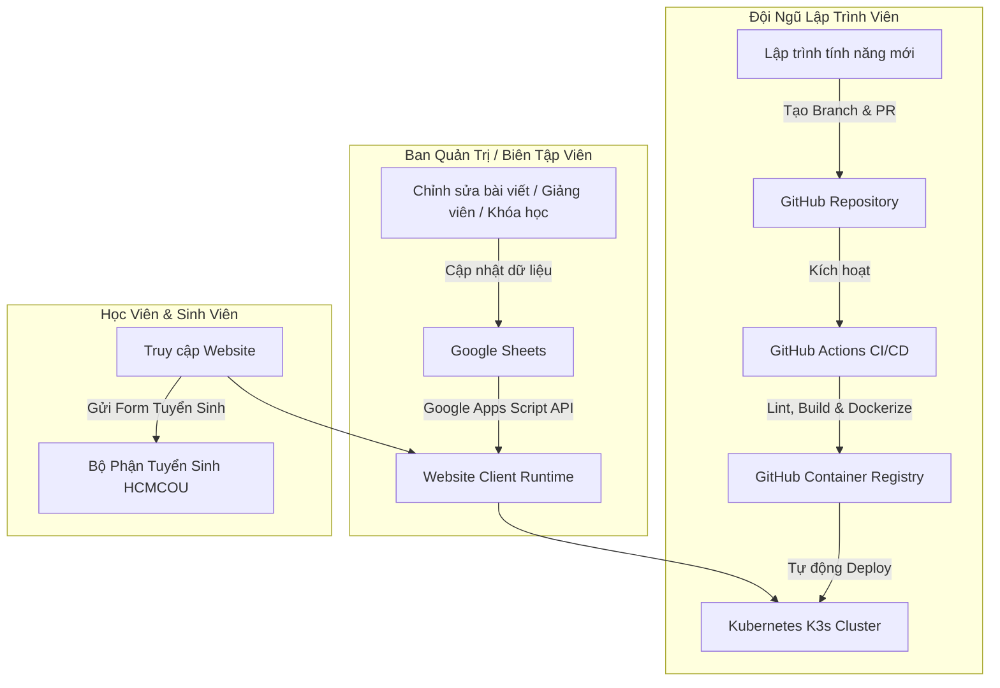
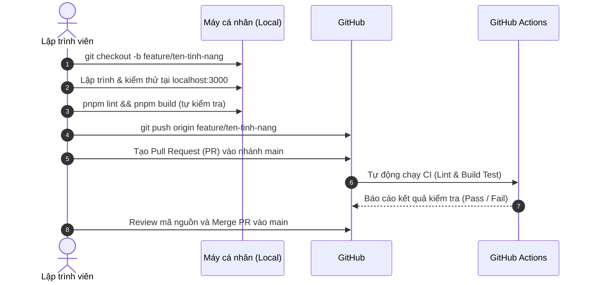
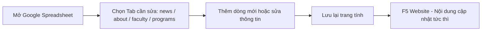
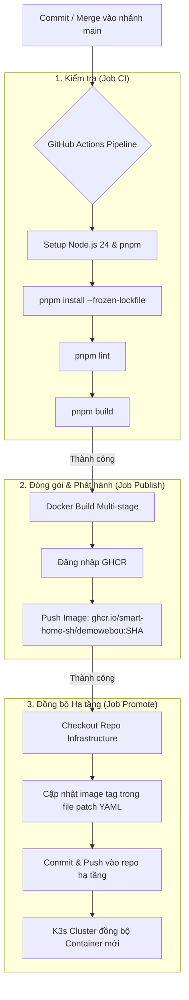
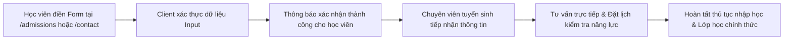

# QUY TRÌNH LÀM VIỆC DỰ ÁN (PROJECT WORKFLOW)
**Dự án**: Website Cổng thông tin & Tuyển sinh Trung Tâm Việt - Hàn (HCMCOU)  
**Tài liệu**: Quy trình phát triển, quản lý nội dung và triển khai tự động (CI/CD)  
**Ngày cập nhật**: 23/11/2026  

---

## MỤC LỤC
1. [Tổng quan quy trình (High-Level Overview)](#1-tổng-quan-quy-trình-high-level-overview)
2. [Quy trình phát triển phần mềm (Development Workflow)](#2-quy-trình-phát-triển-phần-mềm-development-workflow)
3. [Quy trình quản lý & cập nhật nội dung (Content Management Workflow)](#3-quy-trình-quản-lý--cập-nhật-nội-dung-content-management-workflow)
4. [Quy trình CI/CD & Triển khai (CI/CD Deployment Workflow)](#4-quy-trình-cicd--triển-khai-cicd-deployment-workflow)
5. [Quy trình tiếp nhận & xử lý thông tin tuyển sinh (Lead Handling Workflow)](#5-quy-trình-tiếp-nhận--xử-lý-thông-tin-tuyển-sinh-lead-handling-workflow)
6. [Quy chuẩn mã nguồn & Cam kết chất lượng (Quality Standards)](#6-quy-chuẩn-mã-nguồn--cam-kết-chất-lượng-quality-standards)

---

## 1. TỔNG QUAN QUY TRÌNH (HIGH-LEVEL OVERVIEW)

Hệ thống vận hành theo 3 luồng chính:
1. **Luồng Kỹ thuật (Technical Flow)**: Lập trình viên phát triển $\rightarrow$ Git Branch $\rightarrow$ Pull Request $\rightarrow$ Tự động Lint & Build $\rightarrow$ Merge $\rightarrow$ Tự động đóng gói Docker & Triển khai lên K3s Staging/Production.
2. **Luồng Biên tập viên (Content Flow)**: Ban quản lý / Biên tập viên cập nhật dữ liệu (Tin tức, Giảng viên, Khóa học) trên Google Sheets $\rightarrow$ Hệ thống website tự động nạp dữ liệu thời gian thực qua Google Apps Script API mà không cần can thiệp vào mã nguồn.
3. **Luồng Người dùng & Tuyển sinh (User & Admissions Flow)**: Học viên truy cập website $\rightarrow$ Xem thông tin $\rightarrow$ Gửi form đăng ký tư vấn $\rightarrow$ Hệ thống tiếp nhận thông tin và chuyển về bộ phận tuyển sinh.



---

## 2. QUY TRÌNH PHÁT TRIỂN PHẦN MỀM (DEVELOPMENT WORKFLOW)

### 2.1. Phân nhánh Git (Git Branching Strategy)
Dự án áp dụng mô hình **Trunk-Based / Feature Branching** tinh gọn:
- `main`: Nhánh production ổn định. Mọi commit vào `main` sẽ kích hoạt pipeline build Docker image và deploy lên hệ thống.
- `feature/<tên-tính-năng>`: Nhánh làm tính năng mới (ví dụ: `feature/dark-mode`, `feature/tuition-calculator`).
- `webviethan`: Nhánh tính năng hoàn thiện website Trung tâm Việt - Hàn.
- `fix/<tên-lỗi>`: Nhánh sửa lỗi phát sinh.

### 2.2. Các bước làm việc cho Lập trình viên



#### Bước 1: Chuẩn bị môi trường làm việc
```bash
# Cài đặt đúng phiên bản thư viện
pnpm install

# Tạo nhánh làm việc mới từ main mới nhất
git checkout main
git pull origin main
git checkout -b feature/ten-tinh-nang
```

#### Bước 2: Lập trình & Kiểm tra cục bộ
```bash
# Khởi chạy server phát triển
pnpm dev

# Trước khi commit, bắt buộc chạy kiểm tra:
pnpm lint
pnpm build
```

#### Bước 3: Đẩy mã nguồn & Mở Pull Request (PR)
- Viết commit message theo chuẩn **Conventional Commits**:
  - `feat: thêm chức năng lọc theo học phí`
  - `fix: sửa lỗi căn lề trên màn hình iPhone SE`
  - `docs: cập nhật tài liệu hướng dẫn`
- Đẩy nhánh lên GitHub và tạo Pull Request vào nhánh `main`.
- Đảm bảo tất cả các bước kiểm tra CI của GitHub Actions đạt trạng thái xanh (Passed) trước khi merge.

---

## 3. QUY TRÌNH QUẢN LÝ & CẬP NHẬT NỘI DUNG (CONTENT MANAGEMENT WORKFLOW)

Hệ thống cho phép ban biên tập và quản lý trung tâm thay đổi nội dung nhanh chóng thông qua **Google Sheets** mà không cần liên hệ kỹ thuật để chỉnh sửa code:



### 3.1. Danh mục các Tab dữ liệu:
| Tên Tab | Mục đích quản lý | Các trường chính |
| :--- | :--- | :--- |
| `news` | Bài viết tin tức, thông báo, học bổng | `slug`, `title`, `titleEn`, `category`, `date`, `excerpt`, `content`, `featured` |
| `about` | Nội dung trang Giới thiệu | `Mã nội dung`, `Tiếng Việt`, `Tiếng Anh` |
| `faculty` | Danh sách giảng viên & chuyên gia | `Tên`, `Chức danh`, `Chuyên môn`, `Tiểu sử`, `Hiển thị (TRUE/FALSE)` |
| `programs` | Thông tin khóa học | `slug`, `title`, `titleEn`, `category`, `duration`, `description`, `features` |

---

## 4. QUY TRÌNH CI/CD & TRIỂN KHAI (CI/CD DEPLOYMENT WORKFLOW)

Dự án áp dụng mô hình GitOps tự động hóa 100%:



---

## 5. QUY TRÌNH TIẾP NHẬN & XỬ LÝ THÔNG TIN TUYỂN SINH (LEAD HANDLING WORKFLOW)


